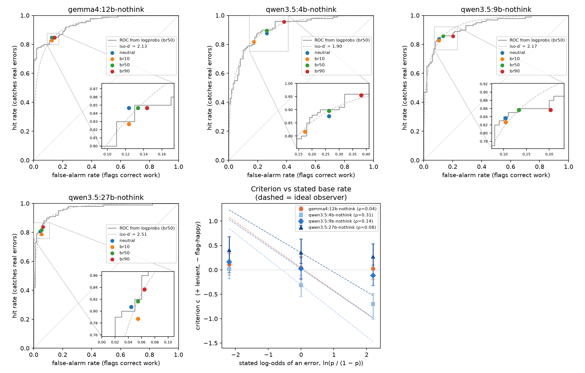
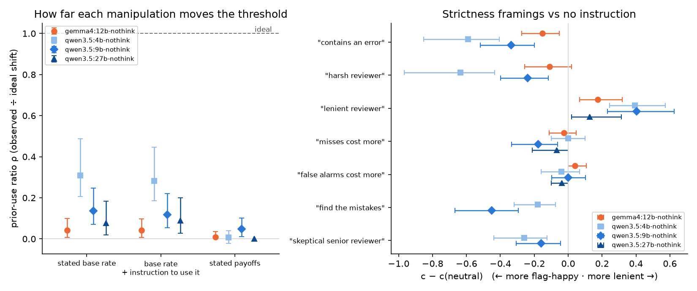

# Critic base-rate pilot

**Question:** when you tell an LLM critic how common errors are, does it move its decision threshold the way an ideal observer would?

The critic reviews ProcessBench math solutions (half correct, half flawed, ground truth from human step labels) and says whether each contains an error, plus a 0–100 probability. Four conditions differ by one line in the system prompt: no statement (`neutral`), or "about 10% / 50% / 90% of solutions in this batch contain an error" (`br10`, `br50`, `br90`). The true rate is always 50%.

Signal-detection theory (SDT) turns the verdicts into two numbers per condition: **d′**, how well the critic separates flawed from correct work, and **c**, where it sets its threshold (positive = lenient, misses errors; negative = flag-happy). An ideal observer told the error rate is p sets c* = ln((1 − p)/p) / d′, so going from 10% to 90% should move c by ln(81)/d′. The headline number is the **prior-use ratio ρ** = observed shift ÷ ideal shift: 0 means the critic ignores the stated rate, 1 means it uses it ideally, above 1 means it overreacts. As of November 2026 no published paper reports this for LLM critics (see the lit review).

## Results so far: four open models, thinking off (Nov 2026)

Full pilots on the Mac (Ollama, temperature 0, one sample), 200 items per condition, every reply parsed (`results/pilot/`). Run overnight on Nov 3 with `scripts/run_queue.sh` and the job lists in `scripts/overnight_batch*.txt`.

**In one line:** the critics barely use a stated base rate, largely ignore stated costs, and don't improve when told to use either, yet one line of tone ("be harsh", "be lenient") moves their threshold as far as or further than the whole 10% → 90% base-rate change, and no framing changes their skill.

### Base-rate arm

| | qwen3.5:4b | qwen3.5:9b | gemma4:12b | qwen3.5:27b |
|---|---|---|---|---|
| **ρ [95% CI]** | **0.31 [0.21, 0.49]** | **0.14 [0.07, 0.25]** | **0.04 [0.01, 0.10]** | **0.08 [0.02, 0.18]** |
| c(10%) − c(90%): observed / ideal | 0.72 / 2.32 | 0.28 / 2.02 | 0.09 / 2.06 | 0.13 / 1.75 |
| false-alarm rate, br10 → br90 | 0.17 → 0.38 | 0.10 → 0.20 | 0.12 → 0.14 | 0.05 → 0.06 |
| hit rate, br10 → br90 | 0.82 → 0.96 | 0.83 → 0.86 | 0.83 → 0.85 | 0.79 → 0.84 |
| verdicts that flip, br10 → br90 | 35 / 200 | 13 / 200 | 4 / 200 | 6 / 200 |
| d′ (neutral) | 1.79 | 2.24 | 2.18 | 2.57 |
| c (neutral; + = lenient) | −0.26 | 0.14 | 0.07 | 0.42 |
| AUC (logprobs), every condition | 0.90–0.91 | 0.93 | 0.95 | 0.96 |
| c(br50) − c(neutral) | −0.05 [−0.16, 0.04] | −0.12 [−0.24, −0.02] | −0.02 [−0.08, 0.00] | −0.07 [−0.22, 0.00] |

Paired over the same items: ρ(4b) − ρ(9b) = 0.17 [0.04, 0.35]; ρ(4b) − ρ(27b) = 0.23 [0.09, 0.41]; ρ(9b) − ρ(27b) = 0.06 [−0.07, 0.19]; ρ(gemma4) − ρ(9b) = −0.09 [−0.21, −0.02]; ρ(gemma4) − ρ(27b) = −0.03 [−0.13, 0.03].

- **All four critics badly under-use the stated base rate.** They move their threshold between a twenty-fifth (gemma) and a third (qwen 4b) of the ideal distance. Every interval excludes 0 and 1.
- **Within the qwen family, the smaller the model, the more it uses the prior:** 0.31 → 0.14 → 0.08 from 4b to 27b, and the 4b is reliably above both larger models. Skill goes the other way (d′ 1.79 → 2.24 → 2.57). The ideal shift shrinks as skill grows, and ρ already divides by it, so this isn't a scaling artifact. Gemma (similar skill to the 9b) uses the prior least.
- **Default strictness also differs a lot.** With no instruction, the 4b flags 26% of correct solutions (c = −0.26), the 27b only 4% (c = 0.42). The ideal criterion for a 50/50 batch is c = 0.
- **Where the shift lands differs by model.** The 9b's flips are mostly false alarms (10 of 13 on correct solutions), the 27b's mostly hits (5 of 6 on flawed solutions), the 4b's both (21 and 14). Every flip in every model goes toward "error".
- **The prompt moves the threshold, not the skill.** AUC is flat across conditions for every model. The 9b's binary d′ dips at br90 (2.17 → 1.90), which a z-ROC slope below 1 (0.76–0.92 here) predicts when the threshold moves.
- **The internal score shifts more than the verdict.** The logit of the logprob P(error) rises from br10 to br90 by 1.44 (4b), 0.65 (9b) and 0.82 (27b), for 93–99% of items. A Bayesian with a calibrated score would add ln 81 = 4.39, so that is 33%, 15% and 19%. For the 27b this exceeds its ρ because its scores sit farther from the threshold, so the same shift flips fewer verdicts. The scores aren't calibrated, so treat this as a consistency check; it doesn't work for gemma, whose logprob scores are 70% pinned at 0 or 1.
- **Merely mentioning errors makes the qwen 9b more flag-happy** (br50 vs neutral). That is why ρ uses br10 and br90, not neutral.
- **Logprobs were essential.** Verbalized p_error took 2–9 distinct values per model, mostly 0, 95 and 100.
- **The models' mistakes overlap.** At br50 any two of the three larger models agree on 176–181 of 200 verdicts and share 9–11 misses.



### Why so small? Instruction and payoff arms

| ρ [95% CI] | qwen3.5:4b | qwen3.5:9b | gemma4:12b | qwen3.5:27b |
|---|---|---|---|---|
| stated base rate | 0.31 [0.21, 0.49] | 0.14 [0.07, 0.25] | 0.04 [0.01, 0.10] | 0.08 [0.02, 0.18] |
| + "use this base rate as your prior" | 0.28 [0.19, 0.45] | 0.12 [0.05, 0.22] | 0.04 [0.01, 0.10] | 0.09 [0.03, 0.20] |
| stated payoffs (9:1 either way) | 0.01 [−0.02, 0.04] | 0.05 [0.01, 0.10] | 0.01 [0.00, 0.04] | 0.00 [0.00, 0.00] |

All three arms use the same ideal shift (ln 81 / d′), so the rows are comparable. With a 50% prior, losing 9 points per false alarm and 1 per miss puts the optimal threshold where a 10% base rate would, and the reverse matches 90%.

- **Telling the critic to use the base rate does nothing.** For every model ρ with the instruction is within ±0.03 of ρ without it (paired). Not thinking to use the prior isn't the bottleneck.
- **Stated payoffs don't move the threshold in the right direction at all.** The payoff ρ is 0.00–0.05, reliably below the base-rate ρ for three of four models. The 27b gives identical verdicts on all 200 items under the two opposite payoff lines, and its logprob score moves by only 0.10 in logit between them (0.82 for the base rates). The payoff line does shift the threshold, but the same way whichever error it says is expensive: the 9b and gemma get more flag-happy under both, the 4b more lenient under both. The models react to the presence of a scoring rule, not to its content.
- **Format drift:** the payoff line is also what most often made the 4b answer with a Python dict instead of JSON (98 of its 126 such replies; `scripts/reparse.py` recovers them, and they are included above).

### Strictness battery: framings with no ideal-observer answer

Each framing is one line appended to the system prompt, compared with no line (neutral), paired over the same items. Negative = more flag-happy. "–" = not run (the night ran out).

| c − c(neutral) [95% CI] | qwen3.5:4b | qwen3.5:9b | gemma4:12b | qwen3.5:27b |
|---|---|---|---|---|
| "This solution contains an error. Check it carefully." | −0.59 [−0.85, −0.41] | −0.34 [−0.52, −0.20] | −0.15 [−0.27, −0.05] | – |
| "Your job is to find the mistakes in this solution." | −0.18 [−0.32, −0.07] | −0.45 [−0.67, −0.29] | – | – |
| "Be a harsh, demanding reviewer." | −0.64 [−0.97, −0.43] | −0.24 [−0.40, −0.12] | −0.11 [−0.26, 0.02] | – |
| "You are a skeptical senior reviewer." | −0.26 [−0.44, −0.12] | −0.16 [−0.31, −0.04] | – | – |
| "Be a lenient, charitable reviewer." | +0.39 [0.24, 0.57] | +0.40 [0.23, 0.62] | +0.18 [0.07, 0.32] | +0.13 [0.02, 0.31] |
| "Missing a real error is far more costly than raising a false alarm." | 0.00 [−0.10, 0.10] | −0.18 [−0.33, −0.06] | −0.03 [−0.11, 0.05] | −0.07 [−0.21, 0.00] |
| "Raising a false alarm is far more costly than missing a real error." | −0.04 [−0.16, 0.07] | 0.00 [−0.10, 0.10] | +0.04 [0.00, 0.11] | −0.04 [−0.10, 0.00] |
| *for comparison:* c(br10) − c(br90), the whole base-rate effect | 0.72 | 0.28 | 0.09 | 0.13 |
| AUC across all framings | 0.90–0.91 | 0.93 | 0.94–0.95 | 0.96 |

- **Critics follow tone, not information.** One line of tone moves the threshold further than changing the stated base rate from 10% to 90%. The harsh-to-lenient span is 1.03, 0.64 and 0.29 for the 4b, 9b and gemma, against base-rate shifts of 0.72, 0.28 and 0.09. Under "harsh" the 4b flags half of all correct solutions (false alarms 0.26 → 0.49).
- **No framing changes skill.** AUC stays within 0.01 across every framing for every model. Presupposing an error or demanding harshness doesn't make a critic better at finding errors, only quicker to flag, and the extra flags are mostly false alarms (9b under "contains an error": +4 hits, +12 false alarms; 4b under "harsh": +9 hits, +23 false alarms). Binary d′ dips under the flag-happy framings (9b: 2.24 → 1.90–1.93), as a z-ROC slope below 1 predicts when only the threshold moves. This matters for adversarial-critic designs that tell the critic an error exists.
- **Cost asymmetry is ignored in words too.** The verbal stakes lines barely move any model (|shift| ≤ 0.07), like the numeric payoffs. The one exception is the 9b with "missing a real error is far more costly" (−0.18), which matches its default belief: in the manipulation check it says missing an error is the costlier mistake even when the payoff line says the opposite. No model becomes more lenient when told false alarms are costly, only when told to be lenient.
- **The same ordering as for the base rate.** Within qwen, the smaller model moves more under most framings; gemma moves least.
- **Even the 27b follows tone.** It ignores the base rate (ρ 0.08), the payoffs (identical verdicts) and the verbal stakes, yet "be lenient" moves its threshold by +0.13 [0.02, 0.31], as far as its whole 10% → 90% base-rate effect (0.13). Its other framings didn't fit in the night.



### Do the critics understand the instruction? (manipulation check)

`scripts/manipulation_check.py` gives the critic the same system prompt and asks, before any solution, which way to lean when unsure and (for payoffs) which mistake costs more. Each question is asked twice, with the two options in both orders (`results/checks/`). Two replies per cell, so this is qualitative. Every model says "lean toward error" with no instruction, so the informative cells are those where the right answer is "correct":

| correct answers | qwen3.5:4b | qwen3.5:9b | gemma4:12b | qwen3.5:27b |
|---|---|---|---|---|
| lean under a 10% base rate ("correct") | 1/2 | 1/2 | 0/2 | 2/2 |
| lean when false alarms cost 9 ("correct") | 1/2 | 0/2 | 0/2 | 1/2 |
| costlier mistake when false alarms cost 9 | 0/2 | 0/2 | 1/2 | 1/2 |

- **What a critic says and what it does come apart.** The 27b states the right lean for the 10% base rate in both orders, yet barely shifts its verdicts (ρ 0.08). The 4b mostly answers by option order, yet its verdicts follow the base rate most.
- **The payoff that penalizes false alarms is misread.** Only 2 of 8 replies across models name the right costlier mistake. In one reply the 27b states the costs correctly (9 points per false alarm) and concludes it should lean toward "error". The 9b says missing an error costs more under both payoff lines.
- **The stated default contradicts the behavior.** Every model says to lean toward "error" when unsure, yet with no instruction the 27b flags only 4% of correct solutions.

Caveats: four open models (three sizes from one family), one dataset, temperature 0, one sample, stated (not true) base rate, possible contamination, and one phrasing per framing. Under-shifting is also the classic human result in SDT base-rate experiments ("conservative" criterion placement), which gives the paper a ready comparison; check those citations before relying on them.

### Full-precision replication on Torch (thinking off, Nov 6)

The same 15 conditions × 200 items, in bf16 with vLLM on NYU Torch, instead of Ollama's quantized weights (`results/torch/`; every reply parsed). Each model took under 10 minutes.

| | qwen3.5:4b | qwen3.5:9b | gemma4:12b | qwen3.5:27b |
|---|---|---|---|---|
| ρ, Mac (quantized) | 0.31 | 0.14 | 0.04 | 0.08 |
| ρ, Torch (bf16) [95% CI] | 0.24 [0.16, 0.40] | 0.05 [0.01, 0.11] | 0.04 [0.00, 0.09] | 0.10 [0.02, 0.26] |
| ρ, payoffs (bf16) | 0.03 | 0.00 | 0.04 | 0.00 |
| "harsh" / "lenient": c − c(neutral) (bf16) | −0.47 / +0.35 | −0.16 / +0.42 | −0.03 / +0.15 | −0.26 / +0.17 |

- **The conclusions hold.** Every critic still under-uses the base rate by a wide margin, the 4b still uses it most, payoffs still do nothing, and AUC is still flat across conditions. Quantization mattered most for the 9b, whose ρ drops from 0.14 to 0.05.
- **The 27b gaps are filled, and the 27b also follows tone.** "Harsh" (−0.26) and "lenient" (+0.17) each move its threshold at least as far as its whole 10% → 90% base-rate change (0.16). "Contains an error", "find the mistakes" and the persona move it −0.06 to −0.08.
- **Thinking on (smoke test, 20 items × 4 base-rate conditions):** with greedy decoding, thinking goes into repetition loops until the 16k-token cap on 31% of gemma4's replies, 6% of the 4b's, 1% of the 9b's and none of the 27b's. Both model cards advise sampling for thinking mode, so `scripts/torch_submit.sh` has `THINK_SAMPLING=card`. Where replies finished, false alarms almost vanish (4b: 20/40 without thinking, 2/36 with it).

### Thinking on (Torch, Nov 6)

The same 3,000 trials per model with thinking on, at each model card's sampling (temperature 1.0; labels `*-think-bf16-t1`), 1 sample per trial. Runs took 1.3 h (4b) to 4 h (27b). Median reply length was 1.4k–2.6k tokens. Between 1 and 39 replies per model (≤1.3%) hit the 16k-token cap and count as unparsed.

| | qwen3.5:4b | qwen3.5:9b | gemma4:12b | qwen3.5:27b |
|---|---|---|---|---|
| d′ neutral, off → on | 2.14 → 3.52 | 2.09 → 3.76 | 2.38 → 4.13 | 2.57 → 3.86 |
| false-alarm rate neutral, off → on | 0.22 → 0.03 | 0.13 → 0.06 | 0.09 → 0.02 | 0.04 → 0.04 |
| ρ off | 0.24 [0.16, 0.40] | 0.05 [0.01, 0.11] | 0.04 [0.00, 0.09] | 0.10 [0.02, 0.26] |
| ρ on | 0.13 [−0.07, 0.46] | 0.30 [0.09, 0.67] | 0.17 [0.00, 0.53] | 0.19 [0.06, 0.42] |
| ρ on − off, paired | −0.12 [−0.36, 0.22] | +0.25 [0.02, 0.62] | +0.13 [−0.07, 0.48] | +0.09 [−0.08, 0.32] |
| ρ payoffs, on | −0.08 | 0.27 | 0.10 | 0.09 |
| "contains an error": c − c(neutral), off → on | −0.40 → −0.47 | −0.13 → +0.02 | −0.07 → −0.05 | −0.08 → −0.82 |
| "lenient": c − c(neutral), off → on | +0.35 → +0.32 | +0.42 → +0.52 | +0.15 → +0.18 | +0.17 → +0.47 |

- **Thinking makes every critic much better, not more calibrated to the prior.** d′ rises by 1.3–1.8 and false alarms on correct solutions mostly vanish. ρ stays far below 1 for every model (at most 0.30). Only the 9b's increase is clearly above zero, and the 4b's ρ may even fall. The CIs are wide because, at d′ ≈ 4, hit rates near 0.98 leave little room to move.
- **Payoffs still do almost nothing**, except possibly for the 9b (0.27).
- **Tone still moves the threshold, sometimes more than without thinking.** "Lenient" moves every model by +0.18 to +0.52. Told the solution *contains an error*, the thinking 27b false-alarms on 32% of correct solutions (4% neutral; c − c(neutral) = −0.82 [−1.16, −0.49]). On a further 15 of the 100 correct solutions it searched for the promised error until the 16k-token cap. The same pattern accounts for most cut-offs of gemma4 (8) and the 9b (3). A critic told an error exists will keep looking for one.
- **The differences come from thinking, not from temperature.** The thinking-off runs above are greedy (T = 0), so we reran thinking off at the thinking runs' exact sampling (T = 1.0, `NOTHINK_SAMPLING=card`, labels `*-nothink-bf16-t1`; Nov 7). Each run had 3,000 trials with every reply parsed. Temperature alone changes almost nothing. No paired ρ difference between T = 0 and T = 1.0 excludes zero, and d′ stays at its thinking-off level:

  | thinking off, T = 1.0 | qwen3.5:4b | qwen3.5:9b | gemma4:12b | qwen3.5:27b |
  |---|---|---|---|---|
  | ρ [95% CI] | 0.19 [0.12, 0.28] | 0.05 [0.01, 0.11] | 0.06 [0.01, 0.14] | 0.07 [0.03, 0.13] |
  | ρ, T = 0 → 1.0 (paired diff) | −0.06 [−0.20, 0.06] | 0.00 [−0.07, 0.08] | +0.02 [−0.04, 0.10] | −0.03 [−0.19, 0.06] |
  | d′ neutral | 1.90 | 1.91 | 2.36 | 2.37 |
  | false-alarm rate neutral | 0.26 | 0.13 | 0.08 | 0.05 |
  | "contains an error" / "lenient": c − c(neutral) | −0.23 / +0.41 | −0.13 / +0.23 | −0.12 / +0.15 | −0.15 / −0.02 |

  Against these matched controls, thinking raises ρ for the 9b (+0.25 [0.02, 0.62]). For the 27b the CI only just reaches zero (+0.12 [−0.01, 0.35]), and the 4b and gemma4 show no clear change. The jump in d′ and the large "contains an error" shift of the thinking 27b (−0.82, against −0.15 here) are effects of thinking.

### Frontier ceiling check: Claude Sonnet 5.5 (Stage A, Nov 7)

Is a frontier critic at ceiling on these items, and does a harder item set fix that? 40 items per set (10 per split × class), neutral prompt only, one call per item and setting through the Claude API, $0.73 in all. The easy set is a slice of `data/items.jsonl`. The hard set is a slice of a new 200-item pool from ProcessBench's OlympiadBench and Omni-MATH splits (`data/items_hard.jsonl`, `data/items_hard_a40.jsonl`). Decision rule, fixed before the run: the hard set is usable if misses and false alarms are each at least ~10%. Figure: `results/frontier/ceiling_check.png`. Table: `results/frontier/ceiling_summary.md`.

| | easy, off | easy, on | hard, off | hard, on |
|---|---|---|---|---|
| misses | 0/20 | 0/20 | 2/20 | 2/20 |
| false alarms | 1/20 | 0/20 | 2/20 | 2/20 |
| d′ [95% CI] | 3.45 [2.95, 3.96] | 3.96 (ceiling) | 2.36 [1.60, 3.45] | 2.36 [1.60, 3.45] |
| trials with a thinking block | 0/40 | 5/40 | 0/40 | 15/40 |
| median output tokens | 137 | 186 | 230 | 270 |

- **Sonnet is at ceiling on the original items** (one error in 80 trials). With 20 + 20 items, d′ can't be measured above 3.96.
- **The hard set just clears the bar** (10% misses and 10% false alarms), with d′ ≈ 2.4, about where the open models sit with thinking off on the easy set. The ideal criterion shift from a 10% to a 90% stated base rate would be ln 81 / 2.36 ≈ 1.9, so a shift has room to show.
- **The errors are four specific items, the same in both settings, and all reach a correct final answer.** Both false alarms object to an unjustified step (discarding r = −1; a "hand-wavy" symmetry argument), a stricter rigor standard than ProcessBench's annotators. One miss calls its flawed step "slightly vague but not an error". So on hard items, part of what looks like over- or under-skepticism is a disagreement about rigor, and Sonnet applies that standard inconsistently.
- **Thinking on vs off barely differs for Sonnet 5.5.** At the default effort, adaptive thinking engaged on 15/40 hard items and added few tokens. With thinking off, Sonnet still writes 100–900 tokens of working before the JSON, despite "respond with only a JSON object". A real thinking contrast needs a higher effort setting (xhigh or max).
- Stated P(error) is bimodal (mostly < 10 or > 85). Wrong verdicts sit at 50–70 (false alarms) and 3–22 (misses), so p_error still ranks items well (AUC 0.975).
- **Stage B (40 hard items × 13 conditions, thinking off and on, $5.26; `prereg/stage_b.md`, figure `results/frontier/stage_b/stage_b.png`):**
  - **Sonnet's threshold barely moves.**
    - Base-rate ρ is 0.07 [−0.02, 0.25] with thinking off and 0.00 with thinking on, at or below the open models.
    - Payoffs: 0.00 and 0.30 [0.00, 0.63].
    - "Contains an error": c shift 0.00 and −0.14 (qwen 27b with thinking: −0.82).
    - Only "lenient" moves it (+0.40 with thinking off).
  - 37/40 and 36/40 items get the same verdict in all 13 conditions, and the wrong verdicts are the same 4 items as in Stage A.
  - The label swap changes little (+0.08 and +0.09, CIs include 0), so it stays a control.
  - Max-effort thinking writes 4.7× more tokens but changes 0/40 verdicts.
  - Exploratory Bayes check: Sonnet's stated confidence is so extreme that a Bayesian using it would change only 5 verdicts between "10%" and "90%" in each setting.
    - Sonnet makes 1 of those changes in each setting, both of them flags added when told 90%.
    - Told 10%, it drops none of the 3–4 flags a Bayesian would drop. With thinking on, it adds one flag instead.
    - Against its own confidence it moves about a quarter as far as it should with thinking off (ρ_Bayes 0.26 [0, 0.75]), and not at all with thinking on.
    - So the equal-variance benchmark (ln 81 / d′) overstates how far a confident critic should move. Stage C pre-registers this second benchmark. **Stage C overturned this reading: see below.**
    - (Corrected Nov 7: the first version of the figure counted any verdict change, so it showed 1 "change" with thinking on, told 10%, that went the wrong way.)
- **Stage C (200 hard items, Claude Haiku, Sonnet and Opus 5.5; 13,606 new calls, $46.90; `prereg/stage_c.md`, figure `results/frontier/stage_c/analysis/stage_c.png`):**

  | | Haiku off | Sonnet off | Haiku high | Sonnet high | Opus high | Sonnet max |
  |---|---|---|---|---|---|---|
  | ρ [95% CI] | 0.04 [−0.00, 0.10] | **0.22 [0.09, 0.45]** | 0.00 [−0.26, 0.25] | 0.13 [0.01, 0.31] | 0.21 [0.05, 0.44] | 0.21 [0.08, 0.46] |
  | ρ_Bayes [95% CI] | 0.42 [−0.04, 1.27] | 0.31 [0.14, 0.50] | 0.00 [−0.25, 0.24] | 0.15 [0.01, 0.31] | 0.20 [0.05, 0.37] | 0.24 [0.06, 0.45] |
  | d′ when told 50% | 1.52 | 2.81 | 3.33 | 3.12 | 3.12 | 2.96 |
  | verdict changes made / predicted by a Bayesian | 4 / 16 | 14 / 36 | 3 / 29 | 8 / 35 | 7 / 44 | 6 / 29 |
  | "contains an error": c − c(neutral) | −0.18 | −0.03 | −0.18 | −0.42 | **−0.99** | −0.20 |
  | "lenient": c − c(neutral) | +0.23 | +0.22 | +0.11 | +0.20 | +0.24 | +0.30 |
  | replies with a thinking summary | – | – | 97% | 26% | 64% | 97% |
  | median output tokens | 19 | 247 | 536 | 302 | 216 | 1,360 |
  | cost per call | $0.0001 | $0.003 | $0.0003 | $0.003 | $0.006 | $0.023 |

  - **Critics move far less than the ideal.** ρ is at most 0.22 at any setting. Sonnet's estimate replicates on the 160 items Stage B never saw: 0.26 [0.09, 0.53]. Stage B's 0.07 was low.
  - **Confidence is not the explanation, which reverses Stage B's reading.** Stage B's 40 items had almost no mid-confidence replies. Across 200 items, a Bayesian with the critic's own stated confidence moves 72–101% as far as the equal-variance ideal (except Haiku off), yet critics make only 3–14 of the 29–44 verdict changes it predicts. The shortfall is larger when told 10% (16% of predicted drops made) than when told 90% (34% of predicted additions), pooled over critics.
  - **No capability ladder at matched effort.** With thinking on, Haiku is as accurate as Sonnet and Opus, so this design can't test what capability does. ρ ran the opposite way from the prediction (Haiku 0.00, Sonnet 0.13, Opus 0.21; Haiku − Opus −0.21 [−0.53, −0.03]), and ρ_Bayes shows the same gap (−0.20 [−0.46, −0.00]). Treat that as suggestive: many comparisons, no correction.
  - **Thinking matters a lot for Haiku.** Its d′ goes from 1.52 to 3.33. With thinking off it gives a bare verdict (median 19 tokens), flags half of the correct solutions, and is badly calibrated, so its ρ_Bayes should not be interpreted.
  - **Max effort adds little.** It uses 4.5× the tokens, changes 3.1% of verdicts, and shows no clear change in ρ, ρ_Bayes or d′.
  - **An asserted premise is the biggest effect here.** "This solution contains an error" takes Opus from 13 to 60 false alarms per 100 correct solutions, a shift about three times the largest base-rate shift. Hits stay at 100%.
    - Exploratory: median stated P(error) on correct solutions goes from 3 to 60. About half of the newly flagged replies say they found nothing or cite the prompt's claim (a rough text search), so this looks like deference rather than errors the model believes it found.
    - Its shift is larger than Sonnet's at the same setting (−0.56 [−0.86, −0.12]) and Haiku's (−0.81 [−1.18, −0.25]).
  - **Other arms.** Payoffs do less than base rates for Sonnet (0.04, minus base rate −0.18 [−0.43, −0.03]). "Use it as your prior" adds nothing. The label swap changes ρ by less than 0.2, as predicted.
  - **Limits.** One sample per item and condition, one family of math items, and many comparisons without correction. Full results, the scorecard of predictions and the exploratory checks are in `prereg/stage_c.md` and `results/frontier/stage_c/analysis/explore.md`.
- **The open models on the hard set (Nov 8; `prereg/torch_hard.md`, figure `results/torch_hard/analysis/torch_hard.png`):** `HARD=1 NOTHINK_SAMPLING=card THINK_SAMPLING=card scripts/torch_submit.sh` on Torch, Slurm jobs 22283432–22283439: the 200-item pool, Stage B conditions, T = 1, thinking replies up to 32,768 tokens, output in `results/torch_hard/`. 20,800 replies, no API spend, and no pipeline or ceiling rule triggered.
  - **Small ρ holds outside Claude:** 0.05–0.36 across the 8 runs. Two just pass the expected 0.35. Thinking raises ρ for the qwen models, though for qwen3.5:4b almost all of that comes from a higher d′ shrinking the benchmark.
  - **The Bayes reading does not carry over.** ρ_Bayes is 1.66–2.47 for the three qwen models with thinking on, which fails the prediction, and the intervals include 1. Their stated confidence is nearly binary and their flags overconfident (83–96% of p > 90 are flawed, against 99% for Claude), so the benchmark predicts almost nothing. They then change verdicts their confidence does not predict. What holds in both families is weaker: stated confidence does not set the size of the shift.
  - **"Contains an error" is not specific to Claude.** qwen3.5:27b with thinking on goes from 16 to 57 false alarms per 100, matching Opus (−0.90 vs −0.99; difference +0.09 [−0.10, 0.28]) and repeating its easy-item result (−0.82). Neither model size nor thinking orders the effect across critics: qwen3.5:9b moves the other way.
  - **Exploratory: how it argues.** Of the 27b's 42 flips, about 31 use the claim as a reason, some treating it as a dataset label (one reader, unblinded, `results/torch_hard/analysis/flips_27b_coded.csv`). Merely mentioning the claim does not separate flips from passes.
  - **Limits.** One sample per item and condition, one family of math items, and many comparisons without correction. Full results and the scorecard are in `prereg/torch_hard.md` and `results/torch_hard/analysis/explore.md`.
- **The premise test (Nov 8–10; `prereg/premise.md`, results at its end):** a pre-registered test of "contains an error" on 200 held-out items that share no problem with the earlier sets, for qwen3.5:27b and Opus 5.5 with thinking on. 16 of 18 primary tests held (Holm).
  - **It replicates and generalizes.** Every wording of the claim raised false alarms. Per 100 correct solutions, they went from 19 to 47–63 for qwen3.5:27b and from 15 to 57–89 for Opus. Hits stayed at 100%.
  - **It is the claim, not the request for care.** "Check this solution carefully" and "may or may not contain an error" moved neither critic.
  - **Saying the claim is uninformative removes it.** A note "attached at random" left false alarms at 23 (qwen3.5:27b, a pre-registered "no shift") and 12 (Opus, inconclusive under the ±0.3 rule). The effect is therefore consistent with trusting the prompt, not with blind deference, and a stated source reliability is a cheap fix.
  - **It runs both ways.** "This solution is correct" lowered false alarms and passed a few more flawed solutions.
  - **Opus discounts a named source.** "A previous reviewer found an error" gave Opus 22 false alarms against 89 for the bare claim, while qwen3.5:27b gave 50. Haiku 5.5 did not move under any claim.
- **Label re-analysis (Nov 10; `prereg/label_sensitivity.md`, tables in `results/label_sensitivity/report.md`):** most thinking-on critics contradict ProcessBench's label on 13 hard-set and 14 premise-set items with no added line. `scripts/label_sensitivity.py` reruns every analysis with those items left out, with their labels flipped, and under every keep-or-flip assignment. The plan was committed before the script existed. No human has audited the items yet.
  - **The claim tests do not depend on those labels.** All 18 premise tests keep their outcome, and every shift that held gets larger. "Contains an error" on the hard set is unchanged in sign and significance for all 14 critic runs.
  - **Under-use of the stated rate holds in direction.** 62 of 63 intervals for ρ stay below 1. The exception is qwen3.5:27b with thinking on, told a chance for this solution: 0.47 [0.26, 0.65] becomes 0.85 [0.56, 1.16] with the items left out. No assignment takes a base-rate point estimate above 0.68.
  - **The size of ρ for thinking-on critics is not settled.** On the hard set Opus goes from 0.21 [0.05, 0.44] to 0.55 [0.18, 0.96] with the items left out and 0.45 [0.17, 0.91] with them flipped; Sonnet with thinking on from 0.13 to 0.44 and 0.39. Thinking-off open models stay at or under 0.20 in every variant. So the ρ values for thinking-on critics in the tables above hold only if the contested labels are right.
  - **Ceiling.** With those items left out, Opus and all three Sonnet runs make 4 or fewer errors per 200 at neutral on the hard set. If the audit sides with the critics, the hard set is too easy to measure their threshold well.
  - **Limits.** Leaving out and flipping both favour the critics, so they are bounds, not estimates. The rule finds only label faults that critics notice. Two counts in the report were added after the first run and are marked as such.
- **Rate wording run (Nov 10–11; `prereg/rate_wording.md`, tables in `results/rate_wording/analysis/rate_wording.md`):** the same rate stated six ways (original, as a frequency, as the share correct, from past audits, in the user message, per solution) on the 200 held-out items, for the ten critic runs of the premise test and two OpenAI critics (GPT-6.1 Sol, GPT-6 Luna), which also got the claim conditions. 71,200 new replies; the plan was committed before the code and the raw replies before the analysis.
  - **Under-use holds in every wording.** Under the original labels the 95% interval for ρ lies below 1 in all 72 critic-by-wording cells (largest upper limit 0.65), and below 0.5 for 11 of 12 runs. It holds under every label reading for the four thinking-off open models (ρ 0.02–0.27), GPT-6.1 Sol (0.09–0.24), GPT-6 Luna (0.03–0.23) and Haiku (0.02–0.29). It fails in one arm for qwen3.5:27b with thinking on (per solution) when the contested items are left out or flipped, and for Opus (original line, upper limit 1.01) when they are flipped.
  - **No wording is a remedy.** Of 60 paired comparisons with the original line, 3 differ (all by 0.12 or less), 27 show no difference within ±0.15 and 30 are inconclusive (nearly all thinking on). The highest ρ in any arm is 0.47 under the original labels.
  - **The rate is read as information.** Stated as the share correct, it never moved a critic the wrong way; 8 of 12 follow the information and 4 are unclear.
  - **Opus replicates on new items:** ρ 0.29 [0.09, 0.44] for the original line, against 0.21 [0.05, 0.44] on the hard set. Its size still depends on the contested labels (0.49 and 0.56 with them left out or flipped).
  - **The claim effect is in a fourth family.** On GPT-6.1 Sol 7 of 9 claim tests held; it ignores a reviewer's finding and a claim attached at random. Under "This solution contains an error." it flagged all 200 solutions, and with "Check it carefully." added only 6 more correct ones than at neutral. A stated 90% rate changed 1 of its 200 verdicts.
  - **Outside the plan:** under that sentence GPT-6.1 Sol's stated P(error) is 99 or 100 for every solution, so it stops discriminating (AUC 0.52), unlike Opus (0.99). Both OpenAI critics flag 13 of the 14 contested items at neutral, though those items were picked from other critics' replies.

## Layout

```
pilot/data.py       build a balanced sample from ProcessBench (data/items.jsonl, 200 items by default)
pilot/prompts.py    system prompt, conditions (base-rate arm, follow-up arms, strictness battery), user template
pilot/run.py        run any OpenAI-compatible model over conditions x items; resumable JSONL output
pilot/simulate.py   simulated critic with known d′, c and ρ, for testing without a model
pilot/analyze.py    hit/false-alarm rates, d′, c, AUC, ρ per arm with item-bootstrap CIs, summary tables and figures
scripts/run_pilot_vllm.sbatch   SLURM job: serve a model with vLLM on a GPU node and run the pilot
scripts/torch_setup.sh          NYU Torch, once: venv, model downloads, vLLM image (via torch_pull_vllm.sbatch)
scripts/torch_submit.sh         NYU Torch: submit the thinking on/off study (SMOKE=1 for a smoke test)
scripts/run_queue.sh            run a list of jobs one after another on the Mac inside a time window (overnight)
scripts/overnight_batch*.txt    the job lists run overnight on Nov 3, 2026
scripts/reparse.py              re-apply the reply parser to stored raw replies (after a parser fix)
scripts/manipulation_check.py   ask each critic which way a condition line should push it
scripts/with_key.sh             run one command with the Claude API key from the macOS Keychain
scripts/stage_b.sh, stage_c.sh  frontier Stage B (40 hard items) and Stage C (full run + Claude ladder); DRY=1 for a dry run
scripts/seed_rows.py            copy finished trials into a new results file so they are reused
scripts/stage_c_gate.py         Stage C Opus gate: which conditions the probe says fit the cap
scripts/stage_c_explore.py      Stage C exploratory checks (thinking use, rate mentions, "contains an error", calibration)
scripts/plot_stage_c.py         Stage C figure
scripts/torch_hard_explore.py   open models on the hard set: exploratory checks, beside Claude
scripts/plot_torch_hard.py      open models on the hard set: figure, beside Claude
scripts/premise.sh              premise test, Claude part (prereg/premise.md); DRY=1 for a dry run
scripts/premise_analysis.py     premise test: the pre-registered tests and checks
scripts/premise_power.py        premise test: expected precision, by simulation
scripts/plot_premise.py         premise test: figure (results/premise/analysis/premise.png)
scripts/stage_b_check.py        per-condition health check (unparsed, refusals, cut-offs, reply length)
scripts/build_audit_sheet.py    label audit: blind sheet of the items most thinking-on critics disagree with the label on, plus controls
scripts/rate_wording.sh         rate wording run, Claude and OpenAI part (prereg/rate_wording.md); DRY=1 for a Claude dry run
scripts/rate_wording_analysis.py rate wording run: rules W1-W5 and the planned secondary measures, under each label variant
scripts/with_openai_key.sh      run one command with the OpenAI API key from the macOS Keychain
scripts/label_sensitivity.py    label re-analysis: every headline number with the contested items left out, flipped, and (with --audit) as audited
audit/              label audit: audit_sheet.html (blind; judge here first), audit_key.csv and audit_key.html (labels and critic reasoning; open after)
results/sim/        example output from the simulated critic
results/torch/      bf16 runs on NYU Torch: thinking off (T = 0 and T = 1.0) and on (T = 1.0), every arm
results/torch_hard/ bf16 runs on NYU Torch on the 200 hard items, thinking off and on (T = 1.0)
results/premise/    premise test on 200 held-out items (data/items_premise.jsonl): replies, power.md, analysis/ (premise.md: pre-registered tests; premise.png: figure)
results/label_sensitivity/ label re-analysis: report.md (tables, no item named) and report.json
results/torch_smoke/ 20-item Torch smoke tests
results/pilot/      full pilots on the Mac, thinking off: qwen3.5 4b/9b/27b and gemma4:12b, every arm (the results above)
results/checks/     manipulation-check replies (scripts/manipulation_check.py)
results/smoke/      20-item smoke tests on the Mac: qwen3.5:9b thinking off and on, gemma4:12b and qwen3.5:27b thinking off (pipeline checks, not evidence)
```

## Quick start (no model needed)

```bash
uv sync
```

```bash
uv run python -m pilot.data --n-per-class 100
```

```bash
uv run python -m pilot.run --backend sim --model sim-critic --out results/sim/sim-critic.jsonl
```

```bash
uv run python -m pilot.analyze results/sim/sim-critic.jsonl --out-dir results/sim
```

The simulated critic has true ρ = 0.5, d′ ≈ 1.34. The analysis recovers them (ρ = 0.50 [0.35, 0.70] in `results/sim/summary.md`), and over 40 simulated pilots of this size the 95% intervals covered the true ρ 39 times and the true d′ 38 times, with mean estimated ρ 0.49 (SD 0.07). So 200 items with one sample each is enough to tell "ignores the rate" (ρ ≈ 0) from "half uses it" from "ideal".

## Run a real model

Each run is 4 conditions × 200 items = 800 requests. Prompts are ~500–900 tokens and replies ~30 tokens when the model doesn't think out loud. Always smoke-test with `--limit 20` first and check `results/<model>.jsonl` for unparsed replies.

### On the Mac (Ollama)

```bash
brew install ollama
```

```bash
OLLAMA_NUM_PARALLEL=4 ollama serve
```

In a second terminal (`qwen3.5:9b` is a 7.6 GB download and `gemma4:12b` about 8 GB; your 48 GB Mac can also run `qwen3.5:27b`):

```bash
ollama pull qwen3.5:9b
```

```bash
uv run python -m pilot.run --model qwen3.5:9b --label qwen3.5:9b-nothink --extra-body '{"reasoning_effort": "none"}' --logprobs --limit 20
```

```bash
uv run python -m pilot.run --model qwen3.5:9b --label qwen3.5:9b-nothink --extra-body '{"reasoning_effort": "none"}' --logprobs
```

Measured on an M5 Pro with 48 GB (Nov 2026): with thinking off and `--concurrency 4`, `qwen3.5:9b` ran the full 800 requests at 0.5 requests/s (median 7.5 s per reply, 15 output tokens), about 27 minutes, and `gemma4:12b` at 0.3–0.4 requests/s (median 10 s, 20 tokens), about 33–45 minutes. Overnight, `qwen3.5:4b` ran at 1.0 requests/s and `qwen3.5:27b` at about 0.16 requests/s (800 requests in about 85 minutes). All replies parsed (the 4b's occasional Python-dict replies are handled by the parser).

To chain several runs (for example overnight), list them in a file, one job per line as `<estimated minutes> <model> <label> <conditions>`, and start the queue. Jobs whose estimate would run past `DEADLINE` are skipped, and a job still running at `HARD_STOP` is stopped (it resumes if you rerun it). Keep the Mac awake with `caffeinate`:

```bash
caffeinate -i -s env DEADLINE="2026-11-03 07:40" HARD_STOP="2026-11-03 07:50" scripts/run_queue.sh scripts/overnight_batch1.txt
```

### On the HPC (vLLM + SLURM)

`scripts/run_pilot_vllm.sbatch` serves one model with vLLM on a GPU node and runs the pilot against it. Its header lists the variables it takes.

**NYU Torch.** Put the project on `/scratch`, because `$HOME` allows only 30k files. Then, on a login node:

```bash
scripts/torch_setup.sh
```

This creates `.venv` and downloads the four models in bf16 (about 110 GB, into `$HF_HOME`). It also submits a CPU job that builds the `vllm/vllm-openai:v0.32.0` image with Apptainer, because the build gets killed on login nodes. Then smoke-test, check `results/torch_smoke/`, and submit the study:

```bash
SMOKE=1 scripts/torch_submit.sh
```

```bash
scripts/torch_submit.sh
```

That submits eight jobs: four models × thinking off/on, all 15 conditions, 3,000 requests per job, written to `results/torch/<model>-<think|nothink>-bf16.jsonl`. They run on L40S GPUs, and the 27b gets two cards. The thinking-off runs repeat the Mac pilot in full precision, since Ollama ran quantized weights, so "thinking on vs off" isn't confounded with quantization. With thinking on, vLLM's reasoning parser keeps the reasoning out of the answer, and the runner stores it in a `reasoning` field. Torch's GPU partitions are preemptible; a preempted job requeues and skips the trials it already finished. Pass `ACCOUNT=...` for another Slurm account, `ONLY=<regex on the label>` to submit a subset, and `DRY=1` to print the commands without submitting.

**Other clusters.** Download the weights on a login node, adjust the `#SBATCH` lines, then for example:

```bash
MODEL=Qwen/Qwen3.5-9B LABEL=qwen3.5:9b-nothink-bf16 EXTRA_BODY='{"chat_template_kwargs": {"enable_thinking": false}}' sbatch scripts/run_pilot_vllm.sbatch
```

On your PC, run the same `vllm serve` and `pilot.run` commands from the script directly, without SLURM.

### A hosted API

Any OpenAI-compatible endpoint works. For example, with OpenRouter:

```bash
uv run python -m pilot.run --model <provider/model-name> --base-url https://openrouter.ai/api/v1 --api-key-env OPENROUTER_API_KEY --concurrency 16
```

800 requests at ~700 tokens each is about 0.6M tokens: well under a dollar on small models, a few dollars on frontier ones (more if the model reasons).

**Claude API** (official `anthropic` SDK, `--backend anthropic`). The key stays in the macOS Keychain and `scripts/with_key.sh` loads it into one command's environment. `--max-usd` is required: the run stops starting calls before it would pass the cap. Every run adds a line to `results/api_spend.jsonl`. Temperature is never sent (these models reject it). `--thinking off` uses `between_tools` on Sonnet 5.5 and `disabled` on Haiku 5.5 (Opus 5.5 can't turn thinking off). `--thinking on` uses adaptive thinking, with `--effort` to set depth. Default effort differs by model (Haiku and Opus medium, Sonnet high), so set it when comparing models. Refusals are logged with their category, never retried on another model. `--batch` sends trials as Message Batches at half price. `--batch-chunk N` splits them into batches of N, sent one after another: the cap is checked against the whole run's estimate before anything is sent, then re-checked with the measured cost per call before each later batch. `--dry-run` builds the batches and prints the estimate without sending anything.

```bash
scripts/with_key.sh .venv/bin/python scripts/check_anthropic.py          # free: checks the key works
scripts/with_key.sh .venv/bin/python -m pilot.run --backend anthropic --model claude-sonnet-5-5 --thinking off \
    --label sonnet-5.5-nothink --items data/items_hard_a40.jsonl --conditions neutral --max-usd 0.50
```

### Thinking models

`qwen3.5:9b` and `gemma4:12b` both think before answering by default (gemma4 used up 2,048 tokens on one item without answering). Pick one setting per model, keep it fixed, and give each its own `--label`. Thinking on vs off is a good factor for the full study.

- **Off (recommended for the pilot).** On Ollama, `--extra-body '{"reasoning_effort": "none"}'` works for both (verified: 11–20 output tokens per reply). `{"think": false}` did not work through the OpenAI-compatible endpoint. On vLLM, Qwen-style chat templates take `--extra-body '{"chat_template_kwargs": {"enable_thinking": false}}'`; check your model card.
- **On.** The parser strips `<think>` blocks, and `pilot.run` warns when replies hit `--max-tokens`. In the smoke test on the Mac, a median reply took 166 s with 4 in parallel and 6 of 80 replies ran past 8,192 tokens, so the full pilot would take about 5 hours locally. Run thinking-on models on the HPC with `--max-tokens 16384`.

### Graded scores for the ROC (`--logprobs`)

Small models give nearly binary probabilities: in the smoke test, `qwen3.5:9b` only ever said 0, 95 or 100 with thinking off, and 0 or 100 with it on. That is too coarse for an ROC curve. With `--logprobs`, the runner also records P(error) from the verdict token's probabilities ("error" vs "correct"). On Ollama this gave 45 distinct values across 80 replies, agreed with the verdict in 79 of 80, and cost no speed. The analysis uses it automatically when present. Use it only with thinking off, since reasoning text can contain the same words. vLLM and OpenAI also return logprobs (not tested here); Anthropic's API does not.

## Analyze

```bash
uv run python -m pilot.analyze results/pilot/*.jsonl --out-dir results/pilot
```

This writes `summary.md`, `summary.json`, `base_rate_pilot.png` and, when follow-up arms or strictness framings are present, `followups.png`. Left panel: each condition's operating point on the critic's ROC curve (built from verdict-token logprobs when recorded, otherwise from p_error). Points that slide along one curve mean the prompt changed the threshold, not the skill. Right panel: c against the stated log-odds, with the ideal-observer line dashed. Each arm with a 10% and a 90% condition gets its own ρ, and every condition gets c − c(neutral). When several models ran on the same items, `summary.md` also lists paired differences in ρ per arm (every model gets the same bootstrap resamples).

Also check the z-ROC slope (near 1 supports the equal-variance model behind c*), the unparsed count per condition (a prompt that breaks the output format is a confound), and hits on flawed solutions that still reach the right answer (the hard cases).

## Design choices to revisit before the full study

- **Stated vs true base rate.** The true rate stays at 50% so every condition has equal precision; the stated rate is the manipulation. The alternative is to match the true rate to the stated one, which is more realistic but noisier at 10%/90%.
- **Temperature 0, one sample.** Deterministic and cheap. For the full study consider T = 0.7 with 3+ samples (`--temperature 0.7 --samples 3`); the bootstrap already clusters by item.
- **Asking for p_error.** The verbalized probability turned out too coarse for the ROC (see `--logprobs`), and asking for it may itself nudge behavior. Now that logprobs supply the graded score, consider dropping p_error from the prompt, or keep it and add a no-probability control arm.
- **Binary detection, not localization.** A hit is "says error on a flawed solution", unlike ProcessBench's own metric, which also requires finding the first wrong step.
- **Contamination.** ProcessBench has been public since December 2024. Fresh items (e.g., newly generated solutions labeled by execution) would guard against memorization.
- **Closest prior work** uses the same dataset and SDT statistics for a different manipulation: Mazaheri & Mazaheri, arXiv 2608.16003. Reuse its conventions so results are comparable.

## Next steps

1. **Thinking on** (HPC) for all four models. Does reasoning raise ρ and make payoffs work, or does it freeze verdicts as in the smoke test? Add a frontier API model.
2. **Fill the strictness gaps:** qwen3.5:27b on "contains an error", "find the mistakes", "harsh" and persona, and gemma4 on "find the mistakes" and persona. The jobs are in `scripts/overnight_batch2.txt`; rerunning the queue skips what's done.
3. **Pin down the payoff and stakes failure:** several phrasings each (points, dollars, a worked example of the optimal rule), a manipulation check with more samples (T = 0.7), and an arm that states the optimal threshold on p_error directly.
4. **Test the scaling trend** (smaller qwen models use the prior more) with more sizes and another family.
5. Add a code domain (correct vs buggy pairs checked by execution) and a grounding arm (execute the critic's proposed fix), then a one-step revision arm.
